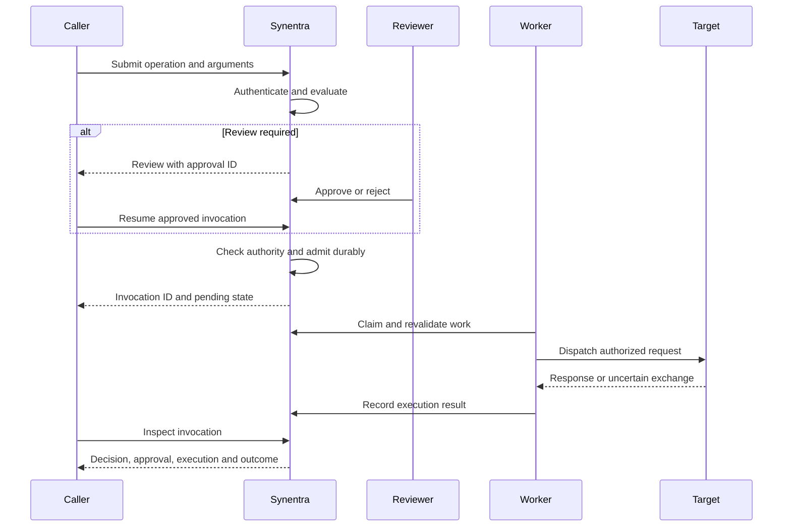

## Sequence

The diagram's dispatch path applies only if governance and admission succeed. Denied or rejected requests do not continue to target dispatch.

## Distinct identifiers and states

Keep invocation identifiers for request tracking and approval identifiers for review actions. Execution inspection uses execution identifiers. Do not infer that these identifiers are interchangeable; the invocation response does not include every internal record identifier.

Decision outcomes are allow, review, and deny. Baseline transport states include not started, claimed, dispatching, responded, failed before dispatch, unknown, and cancelled before dispatch. Outcome verification has a separate status.

## Revalidation

A decision or approval is time-bound evidence. Manifest changes, grant expiry or revocation, credential-authority changes, quarantine, and claim ownership can prevent dispatch after an earlier allow.

Resource resolution and effect planning occur before policy and admission where configured. Budget reservation protects bounded aggregate authority during concurrent submissions.

## Simulation

Simulation uses normalization and evaluation without admitting the requested action. It may still call evidence providers and write audit records. A simulated allow neither reserves capacity nor guarantees future admission.
