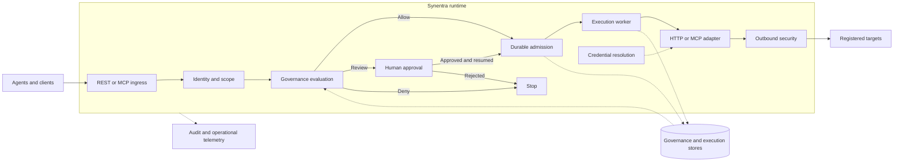

Synentra separates **request evaluation**, **durable admission**, and **governed execution**. External clients and targets sit outside the runtime boundary.

Solid arrows represent request/execution flow. Dotted arrows represent dependencies or persisted evidence. The diagram describes responsibility boundaries, not deployment replicas or independent microservices.

## Request evaluation

Identity supplies the authenticated agent and security scope. Normalization resolves an operation and binding. Governance checks quarantine, hard restrictions, configured intent and risk evidence, resolved resources, bounded effects, and policy.

## Durable admission

Admission checks decision freshness, active revision, grants, quarantine, and budgets. It commits authorized work and its execution snapshot so a later worker uses the admitted request.

## Governed execution

The worker rechecks current authority. Adapters construct target calls; credential resolution supplies permitted credentials, and outbound controls constrain the destination and connection.

## Shared services

SQLite or PostgreSQL stores governance and execution records. Audit connects decisions to subsequent actions. OpenTelemetry requires startup integration to be enabled; the baseline registration is commented out.

See [execution guarantees](execution-guarantees) before designing retries or high-availability behavior.
